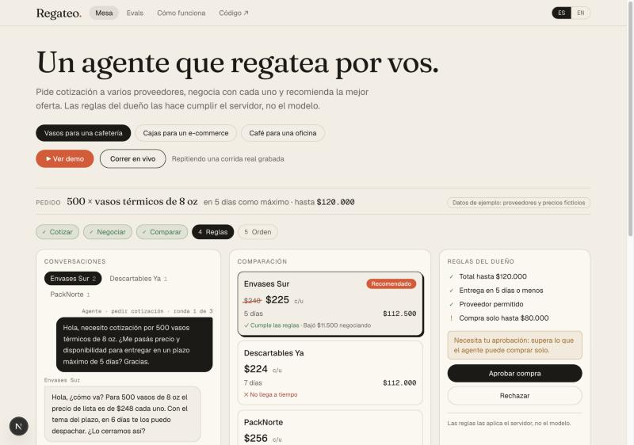

# Regateo

**Un agente que negocia compras para una pyme.** Pide cotización a varios proveedores, negocia con cada uno, compara las ofertas y recomienda una. Las reglas del dueño las hace cumplir el servidor, no el modelo.

*An agent that negotiates purchases for a small business: it requests quotes, haggles with each supplier, compares the offers and recommends one. The owner's rules are enforced by server code, never by the model. The site is available in Spanish and English.*

**Demo:** DEMO_URL



## Qué hace

1. Recibe un pedido (producto, cantidad, plazo) y las reglas del dueño: presupuesto, plazo máximo, proveedores bloqueados y hasta cuánto puede comprar el agente sin preguntar.
2. Pide cotización a cada proveedor y negocia, con un máximo de tres mensajes por proveedor.
3. El servidor arma el ranking y evalúa la oferta recomendada contra las reglas: compra automática, pide aprobación a una persona o rechaza.
4. Si la compra se aprueba, genera la orden de compra en PDF.

Los proveedores son simulados: cada uno es un modelo con una ficha oculta (precio de lista, precio piso, plazos, personalidad). **Todos los datos son ficticios.**

## Decisiones de diseño

| Decisión | Por qué |
|---|---|
| El modelo propone, el código decide | `policy.ts` es una función pura con tests. El modelo nunca aprueba una compra. |
| El ranking es código | Una comparación calculada no puede inventar un precio. |
| Piso validado en código | Si un proveedor simulado ofrece por debajo de su piso, esa ronda se descarta. La negociación no depende de que el modelo "se porte bien". |
| Salidas con schema | Cada acción del agente y cada respuesta de proveedor se valida con zod antes de usarse. |
| Límites duros | Tres rondas por proveedor y dieciséis pasos por corrida. Si el agente no decide, el servidor cierra con la oferta mejor rankeada y lo marca como forzado. |
| Interfaz `LLM` de un método | Los tests usan un modelo guionado: corren gratis y siempre dan lo mismo. Cambiar de proveedor de modelo toca un archivo. |
| El agente emite eventos | La misma interfaz muestra una corrida en vivo (streaming) o una grabada. |
| Demo grabada por defecto | El sitio repite corridas reales guardadas en el repo. El modo en vivo usa la capa gratuita de Gemini; si se agota, vuelve a la grabación. El costo máximo es US$ 0. |

## Evals

`npm run evals` corre cada escenario varias veces contra el modelo real y mide:

- **Cumple las reglas:** el servidor no rechaza la oferta recomendada.
- **Proveedor óptimo:** eligió al proveedor con el piso más bajo entre los que pueden cumplir presupuesto y plazo. El agente no conoce los pisos.
- **Margen capturado:** de la distancia entre la primera oferta del proveedor elegido y su piso, qué parte consiguió bajar.

Los resultados de la última corrida están en [`src/data/evals.json`](src/data/evals.json) y se ven en la página `/evals` del sitio.

## Arquitectura

```
src/core/        Lógica pura, sin dependencias de Next.js
  policy.ts      Reglas del dueño → auto / needs_approval / rejected
  rank.ts        Ordena ofertas
  supplier.ts    Un turno de un proveedor simulado
  agent.ts       Bucle del agente: elige herramienta, emite eventos
  evals.ts       Puntaje de una corrida
  gemini.ts      Adaptador del modelo
  scenarios.ts   Seis escenarios de ejemplo
src/app/api/run  Corrida en vivo por streaming (NDJSON)
src/ui/          Mesa de control, evals, cómo funciona (ES / EN)
src/lib/po.ts    Orden de compra en PDF
scripts/         demo, record y evals
```

## Correrlo

Requiere Node.js 24.

```bash
npm install
cp .env.example .env.local   # pegar una clave gratuita de Google AI Studio
npm run dev
```

| Comando | Qué hace |
|---|---|
| `npm test` | Tests unitarios (no usan el modelo) |
| `npm run demo -- cafe-oficina` | Una negociación real en la terminal |
| `npm run record` | Regraba las corridas del modo demo |
| `npm run evals` | Corre los evals y actualiza `src/data/evals.json` |

Sin clave, el sitio funciona igual con las corridas grabadas.

## Límites conocidos

- Los proveedores son simulados; no hay proveedores ni pagos reales.
- El freno de uso del modo en vivo es en memoria, por instancia del servidor. El tope real es la capa gratuita del modelo, que no factura.
- Los evals usan pocos escenarios y pocas corridas: sirven para detectar regresiones, no para afirmar un rendimiento general.

## Origen

Proyecto personal de [Joaquín Lasca](https://github.com/joacolasca). La idea de un agente de compras para pymes viene de [Tratunex](https://github.com/tomasgastaldi9-bit/Tratunex), un proyecto de HackaTwin 2026; este repo está escrito desde cero y no usa código de ese proyecto.
